<div align="center">


# LocalLife · 本地生活工作台

**安排生活，照顾自己，也给好奇心留一个位置。**

任务与日历 · 健康记录 · 数学实验 · 深度学习 · 每日简报 · 易经文化

中文界面 ｜ 本地优先 ｜ Windows 一键启动 ｜ 可选智谱 AI ｜ GPL-3.0

[开始使用](#quickstart) · [功能导览](#features) · [易经与 AI 解读](#iching) · [AI 配置](#ai-config) · [常见问题](#faq)

</div>

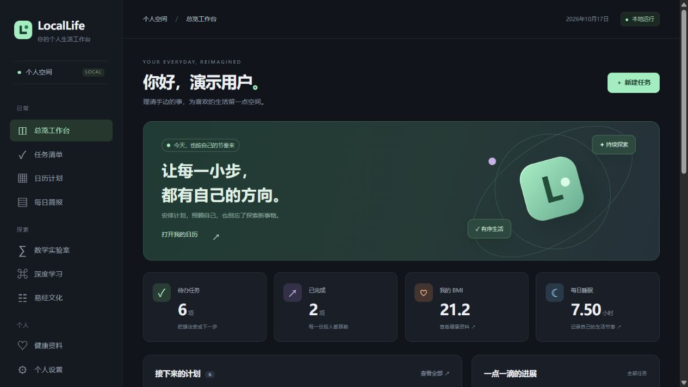

LocalLife 把日常安排和学习工具放进同一个个人空间。你可以先安排今天的任务，再画一条函数曲线、训练一个小模型，或用《周易》的文化视角整理思绪。打开浏览器就能操作，前端与后端由同一个本地服务提供。

**适合想把生活安排得更清楚的个人用户，也适合喜欢数学、编程和动手实验的学习者。** 不需要先学会搭建前后端环境，Windows 发行包双击即可开始。

> 文中截图来自新版真实页面，使用独立演示账号和虚构资料。易经 AI 文案与新闻条目为预置展示样本，便于说明界面，不代表真实预测或实时新闻；数学图像与训练曲线由程序实际运行生成。

<a id="features"></a>
## 一个工作台，九个使用入口

| 入口 | 可以做什么 | 适用场景 |
| --- | --- | --- |
| ◫ 总览工作台 | 查看待办、完成进度、BMI、睡眠记录与工具入口 | 每天打开，快速了解手边的事 |
| ✓ 任务清单 | 新建、编辑、完成任务；安排时刻、时间段和提醒 | 把大目标拆成下一步行动 |
| ▦ 日历计划 | 月历、日视图、跨天任务、节日展示与快速新建 | 安排一周学习、运动或项目计划 |
| ♡ 健康资料 | 记录身体与生活习惯，本地计算 BMI，可选 AI 参考 | 定期回看运动与睡眠习惯 |
| ∑ 数学实验室 | 符号计算、求导积分、解方程、2D / 3D 绘图等 | 验证一道题，理解一个函数 |
| ⌘ 深度学习 | 配置数据与模型、生成 PyTorch 代码、观察训练曲线 | 用一次小实验理解机器学习 |
| ▤ 每日简报 | 同步 RSS、按兴趣筛选、生成摘要并跳转原文 | 集中阅读关心的信息 |
| ☷ 易经文化 | 三币起卦、本卦与之卦、六爻原文、可选 AI 解读 | 传统文化学习与自我反思 |
| ⚙ 个人设置 | 编辑昵称、签名、简介、头像与账号资料 | 整理自己的个人空间 |

### 任务与日历：把“要做”变成“什么时候做”

| 任务清单 | 日历计划 |
| --- | --- |
| 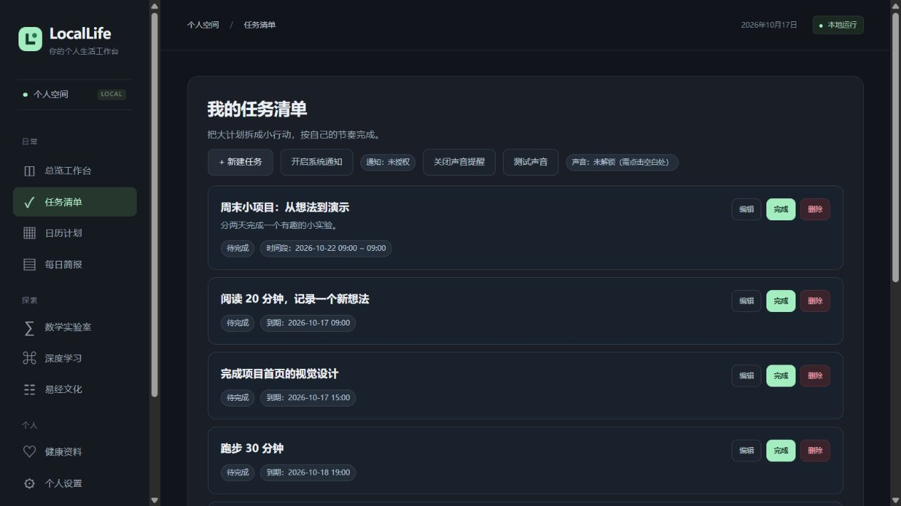 | 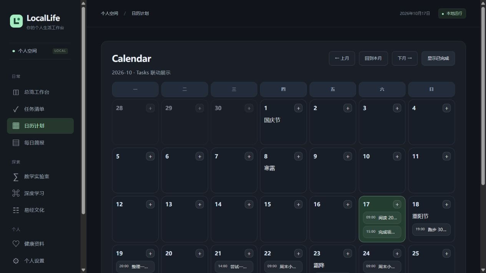 |

- **三种安排方式**：暂不设置时间、指定到期时刻、指定起止时间段。
- **任务联动日历**：已安排时间的任务显示在对应日期，跨天任务覆盖相关日期；点日期进入日视图，点 `+` 快速创建。
- **专注时段**：时间段任务开始后进入专注页并显示剩余时间；可以提前完成，结束后恢复其他功能。它会暂时限制工作台内其他页面的访问，适合专门留出的专注时间。
- **到点提醒**：支持提前量、页面提示、声音与浏览器系统通知。系统通知需授权；声音需先点击页面或测试按钮解锁，服务与浏览器需持续运行。

**试一试**：新建“今晚阅读 20 分钟” → 选择到期时间 → 开启提醒 → 在日历中查看安排 → 完成后回到总览看进度。

### 健康与个人空间：关注日常的小变化

| 健康资料 | 个人设置 |
| --- | --- |
| 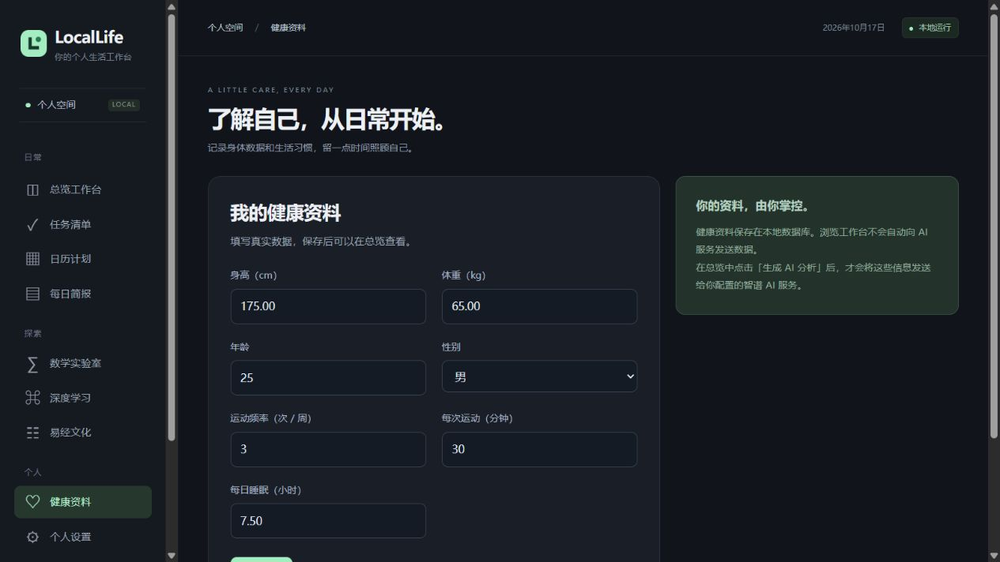 | 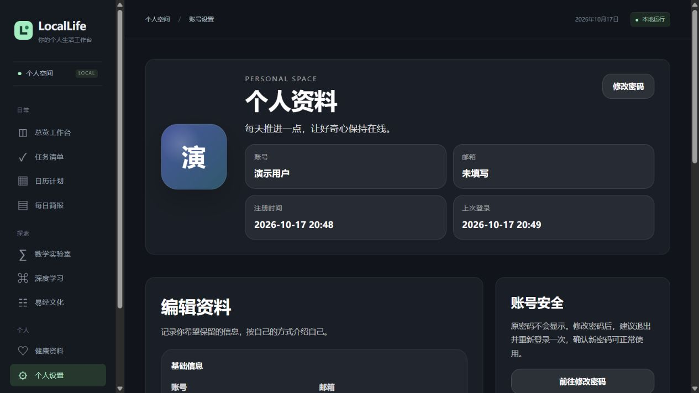 |

记录身高、体重、年龄、性别、每周运动频率、单次运动时长和睡眠时长。保存后，总览会显示本地计算的 BMI 与睡眠信息。需要时可主动点击“生成 AI 分析”，获取生活习惯参考；浏览工作台本身不会触发这项 AI 请求。

个人设置支持昵称、签名、简介、头像、邮箱、生日和展示链接，并提供修改密码入口。账号中的任务、健康资料与个人资料按登录用户管理。健康参考用于生活习惯记录与思考。

### 数学实验室：从表达式到结果，再到图像

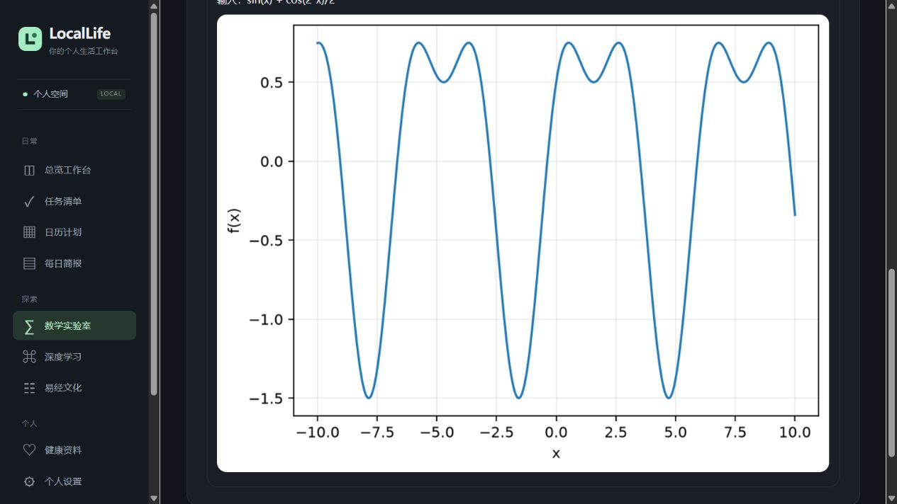

无需写 Python，在页面上选择模式、输入表达式即可计算。支持键盘输入，也提供常用数字、运算符和函数按钮。

| 能力 | 示例 / 用法 |
| --- | --- |
| 计算与化简 | `2*sin(pi/4)+sqrt(2)`、`(x^2-1)/(x-1)` |
| 求导与积分 | 对 `x^3` 求导；对 `sin(x)` 求不定积分或填写定积分上下限 |
| 解方程 | `x^2-2=0`；支持符号解，也可为数值解指定初值 |
| 二维与三维作图 | `sin(x)+cos(2*x)/2`、`sin(x)*cos(y)`；可设置绘图范围与采样数 |
| 线性代数 | 行列式、逆矩阵、特征值 / 特征向量、线性方程组 |
| 极限与泰勒展开 | 设置变量、目标点、方向或展开阶数 |
| ML 工具 | 梯度等辅助计算，适合学习与验证公式 |

表达式使用 `*` 表示乘法、`^` 或 `**` 表示乘方；函数采用 `sin(x)`、`sqrt(x)` 等形式。图中展示的是本地数学引擎生成的实际结果。

### 深度学习：看着代码和曲线，一步步理解训练

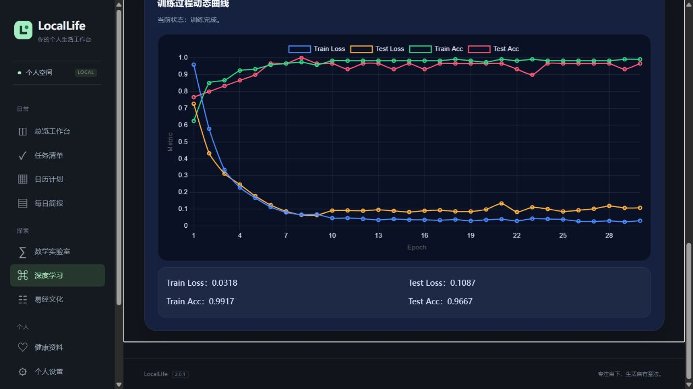

选择数据集与模型后，页面会生成对应的 PyTorch 示例代码；点击“开始训练并可视化”，可观察训练 / 测试损失和分类准确率，并查看最终指标。生成的代码可以复制到自己的 Python 环境继续实验。

| 配置项 | 支持内容 |
| --- | --- |
| 数据集 | 随机回归、随机分类、Iris、Breast Cancer、Digits、MNIST、FashionMNIST |
| 模型 | 线性模型、多层感知机 MLP、自定义公式 |
| 模型参数 | 隐藏层、激活函数、Dropout 等与当前模型相关的参数 |
| 训练参数 | 优化器、学习率、Batch Size、Epochs、随机种子、测试集比例、标准化 |
| 结果 | PyTorch 代码、训练曲线、损失与分类准确率 |

**推荐第一次实验**：数据集选 Iris，模型选 MLP，训练 30 个 Epoch。观察损失下降与准确率变化，再尝试改变学习率。截图是一次演示运行的结果，不代表模型效果保证。

发行包使用 CPU。随机数据与 scikit-learn 内置数据集可离线使用；MNIST / FashionMNIST 首次使用需联网下载。回归任务不显示分类准确率。训练状态保存在当前服务进程中，关闭服务会中止训练。

### 每日简报：读摘要，也保留追溯原文的入口

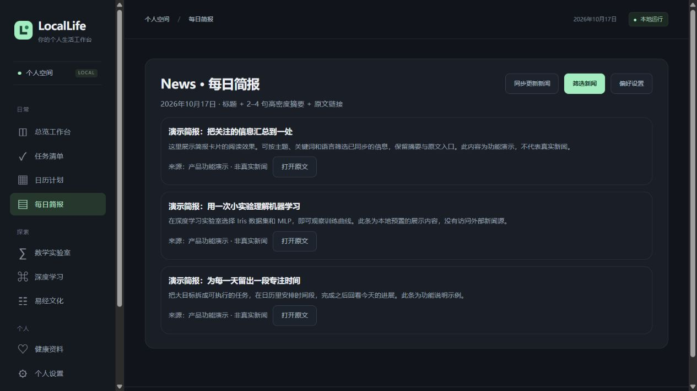

1. 打开“偏好设置”，选择主题、语言、地区、关键词及条目数量。
2. 点击“同步更新新闻”，抓取已配置并启用的新闻源。
3. 点击“筛选新闻”，从近期已同步内容生成当日简报。
4. 阅读标题和摘要，点击“打开原文”查看完整内容。

默认摘要采用本地文本提取方式，不需要 AI 密钥。开发者可在配置中切换摘要后端。新闻同步依赖网络及源站可用性；没有内容时可先放宽主题、语言或关键词。全新数据库由启动器初始化默认新闻源，后台管理也可维护源配置。

<a id="iching"></a>
## 易经文化与 AI 解读：从卦象原文，到可读的自省建议

这是一个将本地《周易》资料与可选 AI 阅读辅助结合的文化体验工具。你可以只看原文，也可以填写一个问题，让 AI 帮助理解所呈现的卦辞、动爻与变化关系。

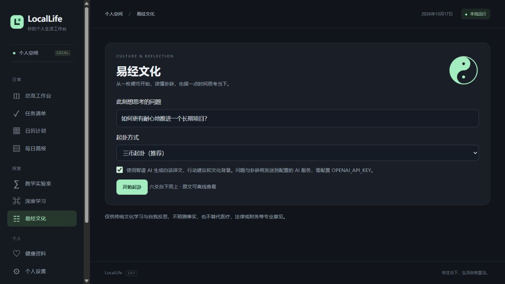

### 一次起卦，会得到什么？

| 结果部分 | 展示内容 |
| --- | --- |
| 本卦 | 卦名、卦符、六爻图形与卦辞原文 |
| 之卦 | 动爻变化后的卦象；没有动爻时会明确提示 |
| 动爻标记 | 第几爻发生变化，图形中以 `×` / `○` 标识 |
| 六爻详情 | 从初爻到上爻展示三枚硬币结果、本卦爻辞与动爻对应的之卦爻辞 |
| AI 白话译文 | 本卦 / 之卦卦辞，以及提供给 AI 的各动爻爻辞的现代汉语表达 |
| AI 行动建议与问题回应 | 结合问题给出可执行的思考方向，并说明结果的不确定性 |
| AI 文化背景 | 可选的背景说明或典故，出处由 AI 提供，需要自行核实 |

三币法连续生成六爻，顺序为**从下往上**；每枚硬币正面计 3、反面计 2。合计 6 为老阴、7 为少阳、8 为少阴、9 为老阳，6 与 9 是动爻。页面绘制卦象时，上爻显示在最上方。随机模式与三币法使用相同的生成分布。

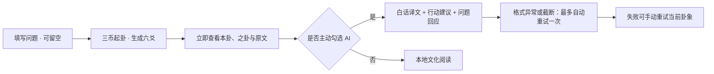

### 三步开始体验

1. 进入“易经文化”，填写问题，例如“如何更有耐心地推进一个长期项目？”；也可留空。
2. 选择三币法。想使用 AI 时，先完成密钥配置并主动勾选 AI，再点击“开始起卦”。
3. 先阅读本卦、之卦与原文，再结合 AI 译文和建议思考下一步行动。

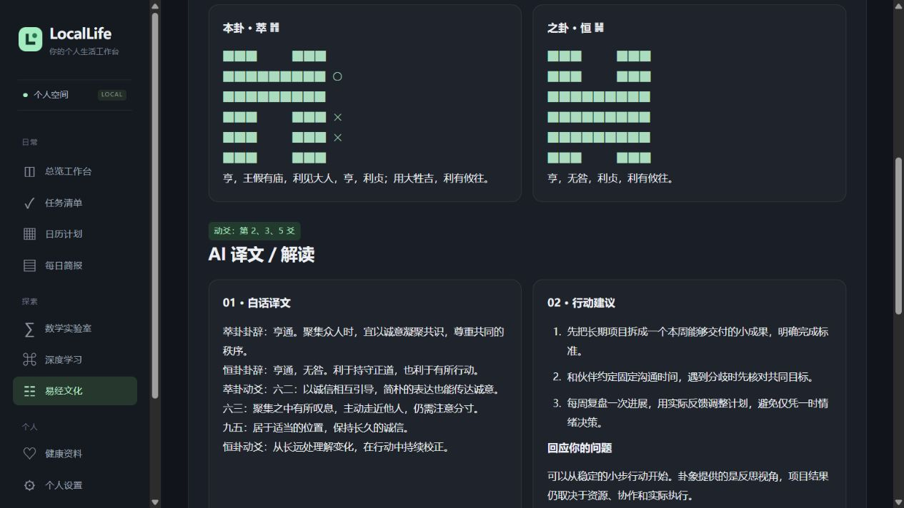

**AI 失败时，已有卦象仍然可读。** 页面提供“重试当前卦象的 AI 解读”，沿用原问题、本卦和动爻，不会重新掷币。重试会再次调用配置的 AI 服务；当前账号的重试凭证有效期为一小时。卦象在当前页面展示，刷新后不会形成历史记录。

2.0.1 修复了返回内容被长度限制截断、外层 `answer` 包装、嵌套译文和字段类型变化导致的失败。程序会验证返回结构，兼容常见格式差异；不会把不完整的回复拼补成完整解读。密钥、额度或网络问题会显示具体处理提示。

> 卦象与 AI 内容仅供传统文化学习和自我反思，不预测事实，也不替代医疗、法律或财务等专业意见。AI 生成的译文与典故可能有误，涉及原典时建议对照可信版本阅读。

<a id="quickstart"></a>
## 开始使用

### Windows：双击一键启动

本地构建产物的入口是 `dist/LocalLife-2.0.1/LocalLife.exe`，当前版本 **2.0.1**。Git 仓库保存源码和构建脚本，`dist/` 不提交到 Git；如果只下载了源码，请按下文启动或自行构建。

1. 将完整的 `LocalLife` 发行目录放到可写位置。
2. 双击 `LocalLife.exe`，程序自动初始化数据库、启动服务并打开浏览器。
3. 首次使用注册个人账号，进入总览后即可新建任务或体验其他工具。
4. 服务运行时保留启动窗口；关闭窗口或按 Ctrl+C 即停止服务。

**移动或分发时，复制整个 `dist/LocalLife-2.0.1` 文件夹。** `_internal` 内含运行所需依赖，不能只复制 EXE。发行包内置 Python、后端、页面和 CPU 训练环境，目标电脑无需另装 Python、Node.js 或 CUDA。它是目录式便携程序。

更新已有版本时，先关闭旧版的启动窗口，再启动新版本；同一数据目录会复用已运行实例。构建脚本检测到默认目录的旧程序仍在运行时，会自动改用独立版本目录。

默认访问 `http://127.0.0.1:8765/`。端口被占用时会自动选择附近可用端口，以启动窗口显示的地址为准；再次双击会打开已运行的实例。前后端同服务，无需分别启动。

### 从源码启动

推荐 Windows 10 / 11、64 位 Python 3.12。本次已在 Windows 11 环境验证。

```powershell
python -m venv .venv-desktop
.\.venv-desktop\Scripts\python.exe -m pip install -r requirements.txt
.\.venv-desktop\Scripts\python.exe desktop_launcher.py
```

安装依赖后，启动器会处理数据库迁移与首次数据准备。开发调试也可以运行：

```powershell
$env:DJANGO_DEBUG = "1"
.\.venv-desktop\Scripts\python.exe manage.py migrate
.\.venv-desktop\Scripts\python.exe manage.py runserver
```

日常使用推荐启动器内置的 Waitress 服务。可选创建 Django 管理员以维护新闻源：

```powershell
.\.venv-desktop\Scripts\python.exe manage.py createsuperuser
# 启动后访问 /admin/
```

<a id="ai-config"></a>
## 可选 AI 配置

在**数据目录**建立 `.env`，填入你自己的智谱密钥，然后重启服务。密钥通过服务器读取，不要写进前端或提交到 Git。

```dotenv
OPENAI_API_KEY=你的智谱API密钥
ZAI_BASE_URL=https://open.bigmodel.cn/api/paas/v4
ZAI_MODEL=glm-4-flash-250414
# 可选；不填写时程序自动生成并持久保存本机 Django 密钥。
# DJANGO_SECRET_KEY=足够长的随机字符串
```

变量名 `OPENAI_API_KEY` 用于读取智谱的兼容接口密钥。模型需在自己的智谱账号中可用，并支持 JSON 输出；修改模型、接口地址或密钥后重启。接口说明可查阅[智谱官方文档](https://docs.bigmodel.cn/)。

| 操作 | 是否需要联网 | 会发送什么 |
| --- | --- | --- |
| 任务、日历、个人资料、BMI | 否 | 使用本机数据库 |
| 数学计算、作图、离线数据集训练 | 否 | 在本地执行计算 |
| 健康 AI 分析 | 是，需主动点击 | 已填写的健康资料 |
| 易经 AI 解读 / 重试 | 是，需主动选择或点击 | 当前问题、卦名、卦辞和动爻原文 |
| 新闻同步 | 是 | 请求配置的新闻源；默认摘要在本地生成 |
| MNIST / FashionMNIST 首次下载 | 是 | 请求数据集下载地址 |

AI 使用受所选服务的额度、模型权限和服务条款约束；返回内容可能不准确。未配置密钥时，本地任务、日历、数学、卦象原文和离线训练仍可使用。

## 数据保存、备份与迁移

| 启动位置 | 默认数据位置 |
| --- | --- |
| 本仓库内的 `dist/LocalLife-2.0.1` | 仓库根目录，可沿用已有数据库、`media/` 与 `.env` |
| 复制到其他可写目录的发行包 | EXE 同级的 `userdata/` |
| 指定 `--data-dir` | 你指定的目录 |

```powershell
.\dist\LocalLife-2.0.1\LocalLife.exe --data-dir E:\LocalLifeData --port 8765
.\dist\LocalLife-2.0.1\LocalLife.exe --no-browser
```

主要文件包括 `db.sqlite3`（账号、任务与资料）、`media/`（上传头像）、`.env`（可选配置）、`.secret_key`（本机登录密钥）、`desktop.log`（启动日志）、`data/`（下载的训练数据）。

迁移时先停止服务、保留备份，再将旧数据库与 `media/` 复制到目标数据目录；需要沿用配置时一并迁移 `.env` 和 `.secret_key`。有待执行数据库迁移时，启动器先在 `backups/` 中备份数据库。**发行包排除真实数据库、头像与密钥，但你自己的数据目录仍应妥善备份。**

<a id="faq"></a>
## 常见问题

<details>
<summary><strong>AI 译文 / 解读失败，应该怎么办？</strong></summary>

先保留当前页面，点击“重试当前卦象的 AI 解读”。提示未配置密钥时，检查数据目录的 `.env` 并重启；密钥无效或权限不足时，检查账号与模型权限；额度或频率错误时，检查服务配额；网络错误时，确认能连接配置的接口。持续提示回复截断时，可选择支持更大输出长度的模型。凭证超过一小时或显示无效时，重新起卦即可。

</details>

<details>
<summary><strong>为什么时间段任务开始后，只能看到专注页？</strong></summary>

这是时间段任务的专注行为。可以提前完成当前任务，或等到时间段结束。若只希望有一个到期提醒，请创建“绝对时刻”任务。

</details>

<details>
<summary><strong>没有新闻、没有提醒声音、训练首次很慢？</strong></summary>

新闻需要先同步，再筛选；检查源站可用性与筛选条件。声音先点击“测试声音”或页面解锁，系统通知另需浏览器授权。MNIST / FashionMNIST 首次下载需要网络；建议先用 Iris 或随机数据体验 CPU 训练。

</details>

<details>
<summary><strong>EXE 为什么有依赖目录，体积也较大？</strong></summary>

程序包含 Python、Django、PyTorch、数学与科学计算依赖，采用 PyInstaller 目录式发行。请保留 `_internal`，完整复制发行目录；它不是仅靠单个 EXE 就能独立分发的单文件程序。端口、数据目录和启动日志可在启动窗口查看。

</details>

## 技术结构与开发验证

```text
personallife/
├─ config/                 Django 配置与路由
├─ core/                   总览与健康 AI 入口
├─ tasks/ · planner/       任务、提醒、专注与日历
├─ maths/                  SymPy 计算与 Matplotlib 绘图
├─ deeplearning/           PyTorch 代码生成与训练
├─ analytics_app/          本地卦象资料与智谱 AI 解析
├─ news/                   新闻源、同步、筛选与摘要
├─ profiles/ · players/    健康与个人资料
├─ templates/ · static/    中文页面、样式与交互
├─ docs/screenshots/       新版功能截图
├─ desktop_launcher.py     数据准备、端口选择与服务启动
└─ build_windows.ps1       Windows 发行包构建
```

后端使用 Django 5.2 LTS、SQLite 与 Waitress；前端使用 Django 模板、原生 JavaScript / CSS 和本地图表资源；计算与训练由 SymPy、Matplotlib、NumPy、scikit-learn 和 PyTorch 提供。

```powershell
.\.venv-desktop\Scripts\python.exe manage.py check
.\.venv-desktop\Scripts\python.exe manage.py makemigrations --check --dry-run
.\.venv-desktop\Scripts\python.exe manage.py test
.\.venv-desktop\Scripts\python.exe scripts\verify_training.py
```

自动测试覆盖任务权限、提醒与专注、日历、表单、数学、新闻、代码生成，以及易经 AI 的嵌套 JSON、截断重试、错误提示、凭证权限和页面转义。测试使用 Django 测试数据库或专用 `.runtime-*` 目录，不使用个人数据库。详细范围见[验收记录](VERIFICATION.md)。

### 构建 Windows EXE

```powershell
.\.venv-desktop\Scripts\python.exe -m pip install -r requirements-desktop.txt
.\build_windows.ps1 -ReleaseName LocalLife-2.0.1
# 自检目录必须是没有现存数据库的专用新目录：
.\dist\LocalLife-2.0.1\LocalLife.exe --smoke-test --data-dir .runtime-package-check --no-browser
.\.venv-desktop\Scripts\python.exe scripts\verify_desktop.py dist\LocalLife-2.0.1\LocalLife.exe
```

`requirements-lock.txt` 记录已验证的完整依赖版本。构建采用 `LocalLife.spec`，会检查发行包源码 / 静态资源一致性及敏感文件排除情况，并将 README、中文版本记录、验收记录和截图复制到发行目录。

## 参与改进

欢迎通过 Issue 记录复现步骤、预期结果和运行环境，提交问题时请删除 API 密钥、真实数据库和个人资料。功能建议、界面改进和修复 PR 都欢迎；如果这个小工作台对你有帮助，也欢迎 Star 并分享给喜欢动手探索的朋友。

版本变更见[中文版本记录](CHANGELOG.md)。本项目采用 [GPL-3.0](LICENSE)，第三方依赖与资源见 [THIRD_PARTY_NOTICES.md](THIRD_PARTY_NOTICES.md)。布局设计曾参考 [Linear](https://linear.app/features) 与 [Notion](https://www.notion.com/product/projects) 的工作台组织方式。
