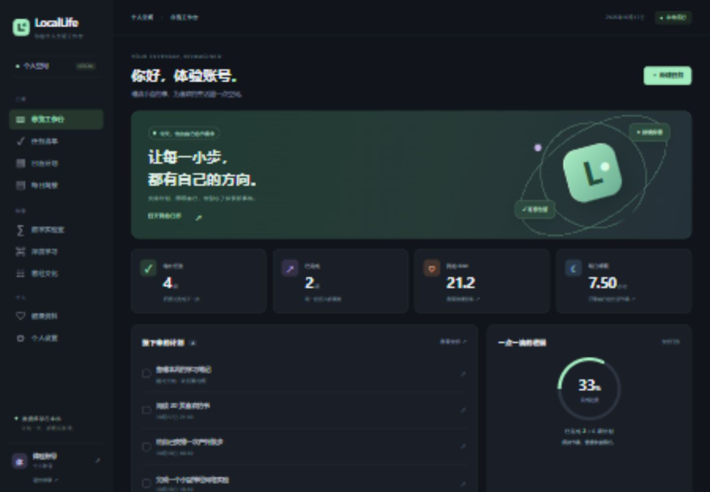

# LocalLife · 本地生活工作台

LocalLife 将任务、日历、健康资料、数学计算、每日简报、易经文化和深度学习实验整合到一个中文个人工作台中。



## 双击启动（Windows）

构建完成的入口：`dist/LocalLife/LocalLife.exe`。

1. 双击 `LocalLife.exe`。程序自动初始化数据库、启动本地服务并打开浏览器。
2. 首次使用注册账号；本仓库内启动时可沿用根目录的既有数据库。
3. 服务运行期间保留启动窗口；关闭窗口或按 Ctrl+C 即停止服务。
4. 再次双击会打开已有实例。默认端口 8765 被占用时自动选择附近端口。

**移动或分发时请复制整个 `dist/LocalLife` 文件夹。`_internal` 是运行所需依赖，不能只拷贝 EXE。** 发行包内置 Python、后端、页面与 CPU 训练环境，目标电脑无需安装 Python、Node.js 或 CUDA。它是目录式便携程序，不是安装器。

原项目为 Django 模板应用，前后端由同一服务提供，无需启动两套进程。

## 数据位置与已有数据

- 从本仓库的 `dist/LocalLife` 启动：使用仓库根目录的 `db.sqlite3`、`media/` 和 `.env`。
- 将发行目录复制到其他可写目录后：使用 EXE 同级的 `userdata/`。
- 可将旧的 `db.sqlite3`、`media/` 复制到目标数据目录以迁移原有资料，操作前关闭服务并保留备份。
- 有待执行数据库迁移时，启动器先将数据库备份至数据目录的 `backups/`。
- 登录密钥位于 `.secret_key`，日志为 `desktop.log`，训练数据位于 `data/`。
- 删除、移动或覆盖数据前请自行保留副本。源码中的真实数据库、头像、密钥不打入发行包。

高级启动参数：

```powershell
.\dist\LocalLife\LocalLife.exe --data-dir E:\LocalLifeData --port 8765
.\dist\LocalLife\LocalLife.exe --no-browser
```

## 从源码启动

推荐 Python 3.12（64 位）。

```powershell
python -m venv .venv-desktop
.\.venv-desktop\Scripts\python.exe -m pip install -r requirements.txt
.\.venv-desktop\Scripts\python.exe desktop_launcher.py
```

开发调试可设置 `DJANGO_DEBUG=1` 后运行 `python manage.py runserver`。日常使用推荐启动器内置的 Waitress 服务。Django 使用仍受支持的 5.2 LTS 分支。

## 可选 AI 配置

在数据目录建立 `.env`（不提交到 Git）：

```dotenv
# 可以不设置；未配置时自动生成并保存本机密钥。
DJANGO_SECRET_KEY=请替换为足够长的随机密钥
# 可选：智谱 OpenAI 兼容接口密钥
OPENAI_API_KEY=你的智谱API密钥
ZAI_BASE_URL=https://open.bigmodel.cn/api/paas/v4
ZAI_MODEL=glm-4-flash-250414
```

重启服务后生效。未配置 AI 时，任务、日历、数学及本地训练均可使用。健康分析需主动点击生成，卦象 AI 解读需主动勾选。**这些操作会把对应健康资料或问题发送到你配置的智谱服务**；新闻同步会访问配置的新闻源。普通浏览健康工作台不触发 AI 网络请求。

## 功能说明

- **任务清单**：无时间、绝对时刻、专注时段；支持提醒、编辑、完成和删除。提醒需要服务与浏览器持续运行，声音需用户手势解锁，系统通知需授权。
- **日历计划**：月视图、日视图、跨天任务、节日及快速新建。
- **健康资料**：身高、体重、年龄、运动与睡眠；本地计算 BMI，按需生成 AI 生活习惯参考。
- **数学实验室**：计算、化简、求导、积分、方程、2D/3D 作图、线性代数、极限、泰勒展开与梯度工具。
- **每日简报**：先同步新闻，再根据主题、语言和关键词生成摘要。启动器会为全新数据库初始化默认新闻源（源码也可执行 `python manage.py seed_news_sources`）；同步依赖网络和源站可用性。
- **易经文化**：三币起卦、本卦与之卦展示、本地卦辞与可选 AI 解读。
- **深度学习**：线性模型、MLP、自定义公式，自动生成 PyTorch 代码并绘制训练曲线。发行包使用 CPU；MNIST/FashionMNIST 首次使用需下载数据。Iris、Digits 等与随机数据可本地使用。训练进度保存在当前进程中，停止服务会中止训练。

## 构建 EXE

在 Windows 中运行：

```powershell
.\.venv-desktop\Scripts\python.exe -m pip install -r requirements-desktop.txt
.\build_windows.ps1
```

`requirements-lock.txt` 记录本次验证的完整依赖版本。CPU 训练、数学和科学计算库会使发行目录较大，请保持足够磁盘空间。PyInstaller 配置为 `LocalLife.spec`，Windows 中文文件版本为 `2.0.0`。

## 验证

```powershell
.\.venv-desktop\Scripts\python.exe manage.py check
.\.venv-desktop\Scripts\python.exe manage.py test
# 必须使用没有现存数据库的专用验收目录：
.\dist\LocalLife\LocalLife.exe --smoke-test --data-dir .runtime-package-check --no-browser
```

回归测试覆盖权限、任务与提醒、专注模式、日历、表单、数学、新闻、代码生成及真实 CPU 训练；不会改写个人数据库。冻结包自检验证主页面、数学绘图和一轮训练。

版本变更详见 [中文版本记录](CHANGELOG.md)，测试范围见 [验收记录](VERIFICATION.md)。设计布局参考 [Linear](https://linear.app/features) 与 [Notion](https://www.notion.com/product/projects)。本项目采用 [GPL-3.0](LICENSE)，第三方资源见 [THIRD_PARTY_NOTICES.md](THIRD_PARTY_NOTICES.md)。
